<div align="center">


# LoveNeverDies

**A companion app for the weeks after a death: the paperwork, the deadlines and the question "do I even want this inheritance?", shared with your family and end-to-end encrypted with post-quantum cryptography.**

Built in ten days for the [Legal Loves Tech Hackathon 2026](https://legallovestech.de/recap/2026) in Munich.


</div>

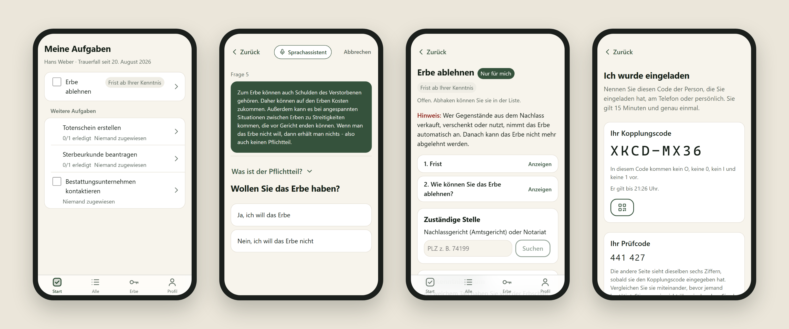

> [!NOTE]
> **This project is archived.** The hosted demo, database, auth instance and voice agent have been shut down. The code, the design documents and the screenshots below stay here as a record of what we built.

## Why this exists

The [Legal Loves Tech Hackathon 2026](https://legallovestech.de/recap/2026) brought 51 participants in 14 teams together around one theme: *access to justice*. The challenges came from the Bavarian Ministry of Justice and the Verbraucherzentrale Bayern. The programme week ran from 17 to 21 August 2026, and the teams pitched to the jury on 27 August in the Freskensaal of the LMU.

We took on challenge **STMJ II, "Was nun? Digitaler Nachlassassistent"** ("What now? A digital estate assistant"), set by the [Bayerisches Staatsministerium der Justiz](https://legallovestech.de/recap/2026/challenges). The brief asked for an interactive guide that walks bereaved people through the most important inheritance steps: the certificate of inheritance, renouncing an inheritance (§ 1944 BGB), the probate court (§ 343 FamFG) and wills. It had to work for older and less tech-savvy people at one of the worst moments of their lives.

That last sentence shaped everything:

- **One thing at a time.** A *simple* view with large type, few buttons and one step per screen. The questionnaire asks one question per page and explains legal terms in place.
- **Deadlines you can't miss.** Renouncing an inheritance has a six-week window that starts when *you* learned of it, not on the date of death. The app works out what applies to you and turns it into a task with a deadline and the address of the responsible court.
- **You don't have to read.** An optional voice assistant can walk you through the questionnaire.
- **Families do this together.** Tasks are shared and can be assigned to someone. Each person's answer to "am I an heir, and do I want to be?" stays private, even from siblings in the same case.
- **It's nobody else's business.** Everything the family writes is encrypted on the device. The server only ever stores ciphertext.

## A tour of the app

All screenshots come from the running app at an iPhone 13 viewport, with made-up data. The UI is German, because the law it explains is.

### Calm by design

<table>
  <tr>
    <td align="center" width="33%">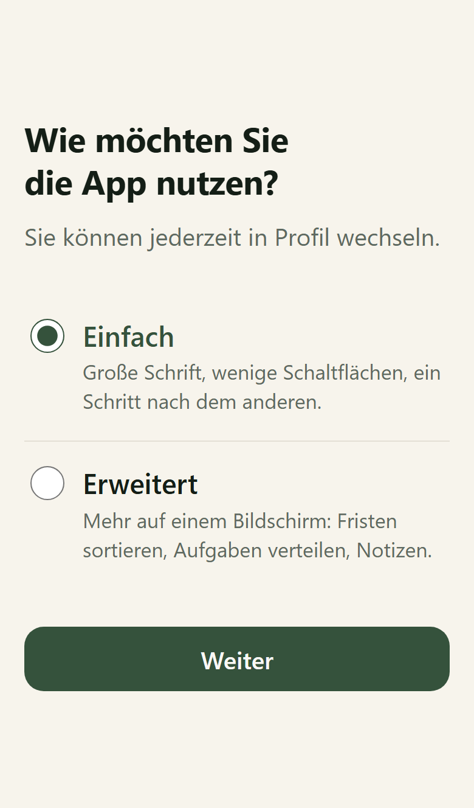<br><sub><b>Pick how much you want to see.</b><br>Simple: large type, one step at a time. Extended: sorting, assignments, notes.</sub></td>
    <td align="center" width="33%">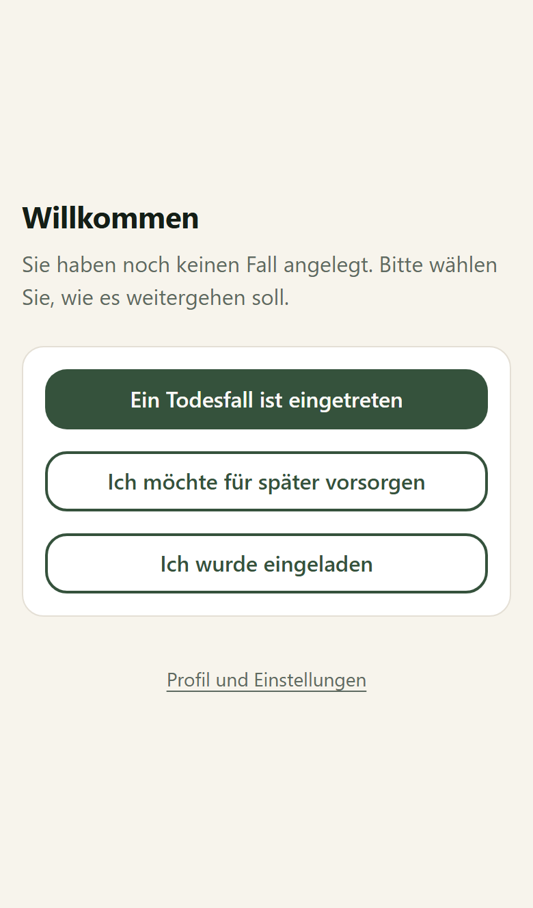<br><sub><b>Three ways in.</b><br>A death has happened, I want to plan ahead, or I was invited.</sub></td>
    <td align="center" width="33%">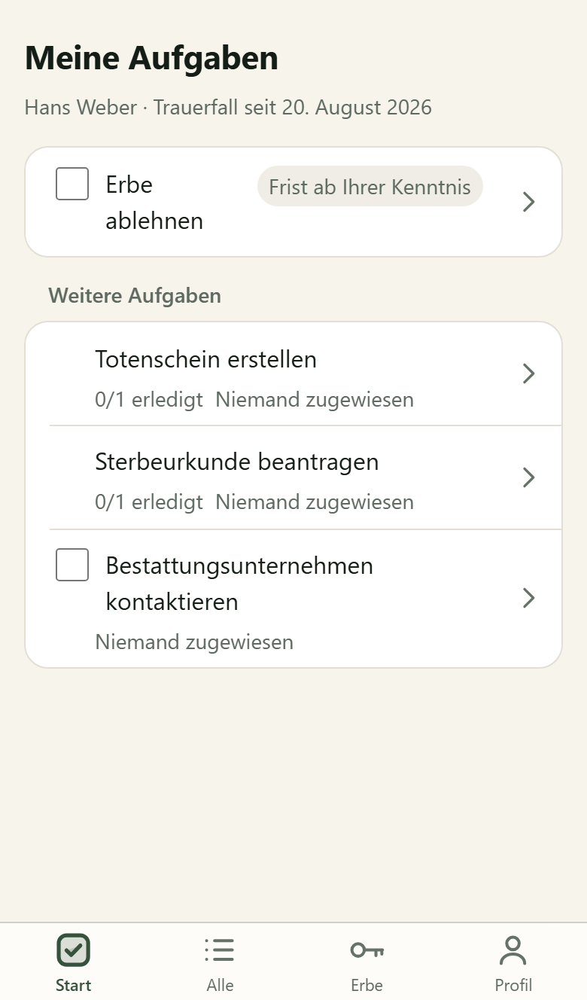<br><sub><b>My tasks.</b><br>What is yours to do, deadlines first.</sub></td>
  </tr>
</table>

### "Am I an heir, and do I want to be?"

A decision tree written by the lawyers on our team: **141 nodes and 80 outcomes**, one question per page, with the browser's back button taking you to the previous question.

<table>
  <tr>
    <td align="center" width="33%">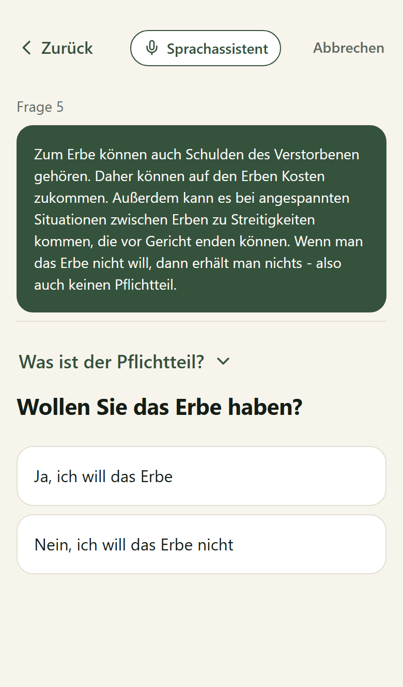<br><sub><b>Explained where it matters.</b><br>Inheriting debt, the compulsory share, and a voice assistant on every page.</sub></td>
    <td align="center" width="33%">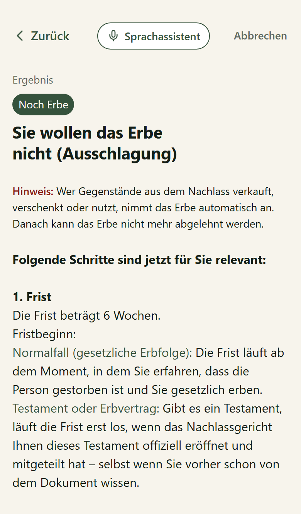<br><sub><b>An outcome, not a verdict.</b><br>What applies to you, and the steps that follow from it.</sub></td>
    <td align="center" width="33%">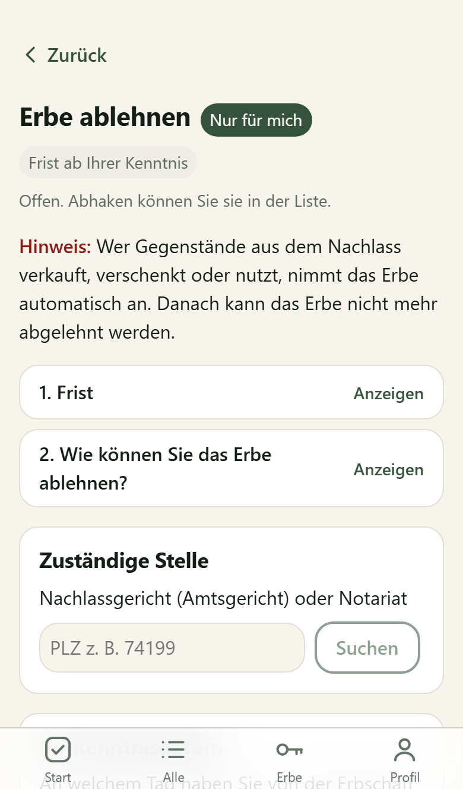<br><sub><b>A private task with a deadline.</b><br>The postcode lookup knows 611 probate courts across 10,813 German postcodes.</sub></td>
  </tr>
</table>

### Together, but private

<table>
  <tr>
    <td align="center" width="33%">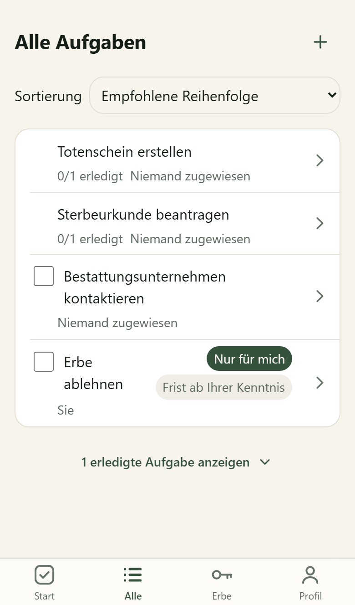<br><sub><b>The whole family's list.</b><br>Shared tasks next to ones marked "Nur für mich" (only for me).</sub></td>
    <td align="center" width="33%">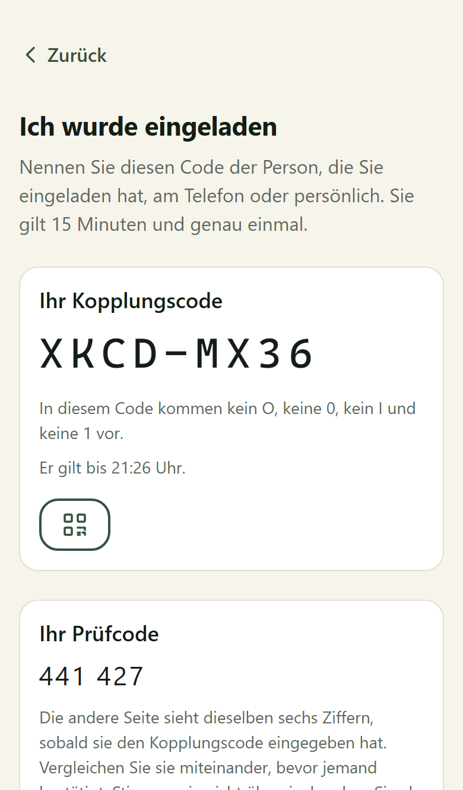<br><sub><b>Joining by phone call.</b><br>An eight-character code you can read aloud, plus six digits both sides compare.</sub></td>
    <td align="center" width="33%">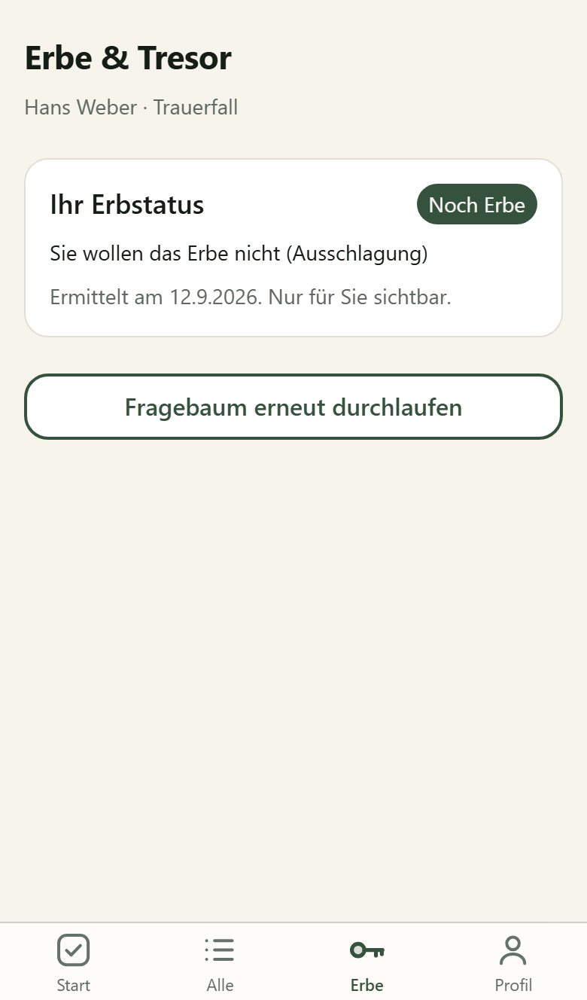<br><sub><b>Your status, yours alone.</b><br>Encrypted under a key only you hold.</sub></td>
  </tr>
</table>

### Before it happens

<table>
  <tr>
    <td align="center" width="33%">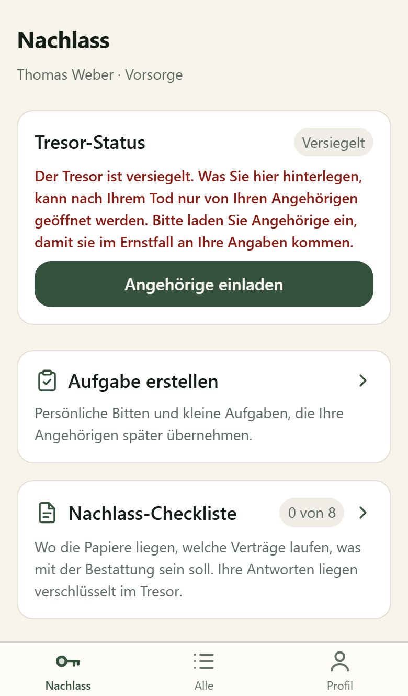<br><sub><b>A sealed vault.</b><br>Where the papers are, which contracts run, what should happen at the funeral.</sub></td>
    <td align="center" colspan="2">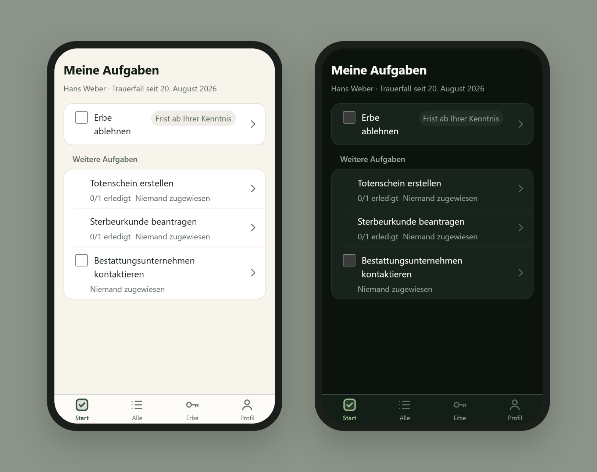<br><sub><b>Light and dark.</b> Respects system theme, text scaling and reduced motion.</sub></td>
  </tr>
</table>

The vault opens only when a two-thirds majority of the invited relatives confirm the death. Until then, nobody can read it: not the relatives, and not us.

## Under the hood

The threat model assumes the server is curious and may actively misbehave, up to swapping public keys. The full reasoning lives in [`docs/DESIGN.md`](docs/DESIGN.md) (German), and the code cites its sections where it matters.

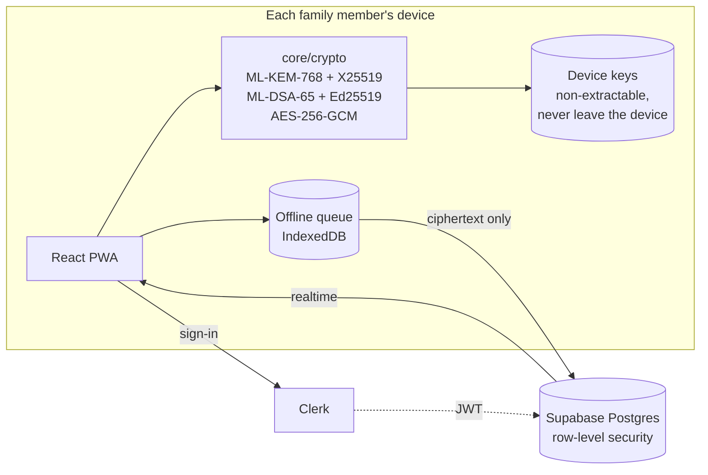

| | |
| --- | --- |
| **Key exchange** | Hybrid ML-KEM-768 + X25519. Breaking it requires breaking both. |
| **Signatures** | ML-DSA-65 + Ed25519. A signature only counts if both verify. |
| **Content** | AES-256-GCM in a versioned envelope. Task titles, notes, deadlines, documents and the name of the deceased are encrypted before upload. |
| **Vault** | Shamir secret sharing, `k = ⌈2n/3⌉` of `n` relatives. The case opens on proof that the key was actually rebuilt, not on a release counter. |
| **Pairing** | A short code via server rendezvous, then a spoken check of six digits derived from *both* public keys, so the server can't slip in its own. |
| **Reminders** | Scheduled on the device from decrypted deadlines. The server never sees a date. |
| **Web** | Strict CSP without `unsafe-inline`, HSTS and a tight `Permissions-Policy`, generated at build time. Telemetry is off. |

<details>
<summary><b>What the server can and can't see</b></summary>

<br>

**Plaintext:** case IDs and status, memberships, public device keys, timestamps, the number of vault releases, and each person's display name and email.

**Encrypted:** task titles, descriptions, deadlines, assignees, notes, documents, subtask structure, completion state, the name and date of death of the deceased, and each person's questionnaire answers and inheritance status.

There is no recovery phrase and no key derived from a password. Lose your only device and you lose access, until another device or another family member grants it again.

</details>

### Engineering notes

- **The database is tested for real.** About 130 Vitest files run against the full chain of 20 migrations on an actual Postgres, compiled to WASM with PGlite, row-level security included. No Docker needed.
- **The architecture is enforced, not hoped for.** `core/crypto` imports neither React nor Supabase, so the `vault-release` Edge Function reuses the same code. ESLint enforces the layering, a test checks that the lint rule really fires, and a new folder that belongs to no layer fails the lint run.
- **End-to-end tests with several people.** Playwright drives mobile WebKit and desktop Chromium through pairing between two people and the full vault lifecycle, from planning ahead to opening after a death.
- **Decisions are written down.** The [ADRs](docs/adr) record, for example, why we removed statute citations from tasks: the app must not look like legal advice ([ADR-0003](docs/adr/0003-keine-rechtsgrundlagen-und-keine-quelllinks.md)).

### Stack

Vite, React 19, TypeScript and react-router as an installable PWA · Clerk for sign-in · Supabase (Postgres, RLS, Realtime, Storage, Edge Functions on Deno) in Frankfurt · `@noble/post-quantum`, `@noble/curves`, `shamir-secret-sharing` and WebCrypto · ElevenLabs Conversational AI for the voice assistant · Vitest, PGlite and Playwright · hosted as static assets on Cloudflare Workers.

## Running it yourself

The hosted services are gone, so you need your own Clerk application and Supabase project. Node 22 or 24 is required.

```bash
npm install
cp .env.example .env.local   # fill in Clerk and Supabase keys
npm run dev
```

[`supabase/README.md`](supabase/README.md) covers the schema, migrations, Edge Functions and the Clerk integration. [`tests/e2e/README.md`](tests/e2e/README.md) covers the Playwright setup. `npm test` runs the unit and database tests without any external service.

## Further reading

- [`docs/DESIGN.md`](docs/DESIGN.md): data model, cryptography, schema, sync, pairing, UI, tests and the limits we accepted (German)
- [`docs/ERBE_DESIGN.md`](docs/ERBE_DESIGN.md): the inheritance questionnaire (German)
- [`docs/adr/`](docs/adr): architecture decision records

## Limitations

This was a hackathon project and never held real data. German law only, German UI only. Not legal advice: the questionnaire was written by lawyers, but it is no substitute for one or for the probate court. The voice assistant sends audio to ElevenLabs, outside the end-to-end encryption. It has never been tested on a real iOS device.

## Team

Built by [@EmanuelMedinaAraujo](https://github.com/EmanuelMedinaAraujo) and [@ClarissaZierl](https://github.com/ClarissaZierl) with the lawyers on our team, who wrote the inheritance decision tree, at the Legal Loves Tech Hackathon 2026, organised by MLTech with the LMU and the TUM under the patronage of the Bavarian Ministry of Justice.

The cryptography stands on Paul Miller's audited [noble](https://paulmillr.com/noble/) libraries and Privy's audited [`shamir-secret-sharing`](https://github.com/privy-io/shamir-secret-sharing).

No license is granted. All rights reserved.
